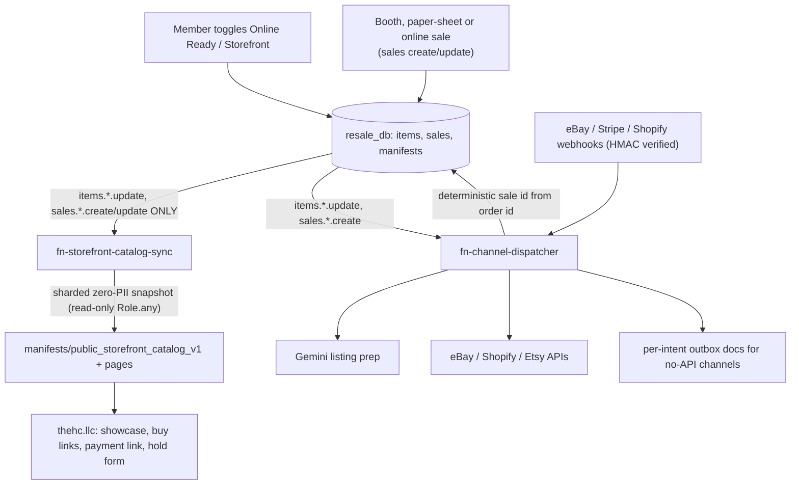

# Online Storefront & Multi-Channel Sync — Cloud-Function-First Architecture Blueprint

> **Status:** Investigation blueprint (Nov 21, 2026). No app code ships from this document.
> **Where to build:** `thehc-platform` (`functions/*`, `packages/core`, `apps/flagship`). `ResaleCommand` and `thehc-platform` share the same live Appwrite database (`resale_db`), so every database event fired from `ResaleCommand` today also triggers new Cloud Functions built in `thehc-platform`.
> **Saved prompts:** see [`docs/prompts/README.md`](prompts/README.md).

---

## 1. The 3 Automation Lanes (and Why Agents Never Log Into Marketplaces)

| Channel | Push listing | Pull orders | Auto-delist on booth sale | Hands-off | Runtime |
| :--- | :---: | :---: | :---: | :---: | :--- |
| **TheHC storefront (`thehc.llc`)** | Auto | Auto (Stripe/Square webhook + hold form) | Auto (seconds) | 100% | Appwrite Cloud Function `fn-storefront-catalog-sync` |
| **Shared eBay store** (Sell Inventory API) | Auto | Auto (notifications + polling cron) | Auto (`withdrawOffer`) | 100% | Cloud Function `fn-channel-dispatcher` |
| **Shopify / Etsy v3 / Square Online** | Auto | Auto (HMAC webhooks) | Auto (inventory 0 / archive) | 100% | Cloud Function `fn-channel-dispatcher` |
| **AI listing copy, category, weight** | Auto | n/a | n/a | 100% | Cloud Function `fn-ai-listing-enricher` (`@google/genai` + Zod 4) |
| **Poshmark, Mercari, Depop, Whatnot, FBMP** | 1-click pre-filled | 1-click harvest / CSV | Auto-queued alert + 1-click delist | ~90% | Member's own browser, driven by the outbox (no public seller APIs) |

> **Never** run headless browsers, cloud agents, or CAPTCHA workarounds against Poshmark, Mercari, Depop, Whatnot, or Facebook Marketplace. They have no public seller listing APIs and gate logins on residential IP reputation and anti-bot challenges; datacenter logins risk permanent seller-account bans. Those channels stay on the client-side outbox, where the member's own logged-in browser performs the action.

---

## 2. Event Loop Safety (Mandatory — Read Before Writing Any Function)

Server-key writes **still fire events**, and Appwrite event wildcards only cover a whole ID segment (you cannot subscribe to `cocur_*`). Every function must therefore:

1. **Subscribe narrowly.** `fn-storefront-catalog-sync`: `databases.resale_db.collections.items.documents.*.update` and `databases.resale_db.collections.sales.documents.*.create` / `.update`. **Never subscribe to `manifests.*.update`** from a function that writes `manifests`.
2. **Return early on its own output.** If the event document `$id` starts with `public_storefront_catalog` or `channel_outbox_`, exit immediately.
3. **Hash before writing.** Compute `syncHash` = SHA-256 of the sanitized output; compare with the hash stored in the target document's `notes`; **skip the write when unchanged** (an unchanged write still fires an update event).
4. **Guard event-only writes.** Follow the existing pattern in `thehc-platform/functions/fn-coop-waterfall-ledger/src/main.ts`: persist only when `trigger === 'event'` and the record is not already marked computed.
5. **Survive bulk bursts.** Bulk inventory updates fire one event per item. Debounce by rebuilding from current database state (not from the event payload) and retry on HTTP 409.

| Function | Reads | Writes | Events it must ignore |
| :--- | :--- | :--- | :--- |
| `fn-storefront-catalog-sync` | `items`, `manifests/cocur_*` | `manifests/public_storefront_catalog_v1*` | any `manifests` event |
| `fn-channel-dispatcher` | `items`, `sales`, `manifests/cocur_*` | per-intent outbox docs, `sales` (deterministic id), marketplace APIs | its own outbox and sale writes (dedupe by order id) |
| `fn-ai-listing-enricher` | `items` | `items.marketDescription` only when blank | updates it made itself (check the written fields before re-running) |

---

## 3. Public Catalog Snapshot (Sharded, Zero-PII)

Single-document limit reality: the Flagship CMS snapshot caps at 60,000 characters (`src/lib/flagshipContentServer.ts`, `MAX_SNAPSHOT_CHARS`). A storefront item with description and photos is roughly 400–600 characters, so one document runs out near 100–150 items.

- **Index document:** `public_storefront_catalog_v1` (page count, `updatedAt`, `syncHash`, total items).
- **Pages:** `public_storefront_catalog_v1_p01` … `pNN`, each at most **54,000 characters** serialized (matches `compactOutboxForSnapshot`).
- **Per item:** image **File IDs** only (max 4, never full URLs, never base64), public description trimmed to about 400 characters, price as integer cents.
- **Permissions:** `Permission.read(Role.any())` only; never grant public update or delete. Pass permissions on update too, so legacy grants are stripped.
- **Schema:** reuse the exact existing `manifests` attributes (`name`, `tenantId`, `locationId`, `locationName`, `status`, `itemsSnapshot`, `itemCount`, `notes`). Zero new Appwrite attributes. Use update-then-create-on-404 exactly like `writeFlagshipCmsOnServer`.
- **Photos:** the item photo bucket must allow public file reads, otherwise shopper-facing images return 401 (add to the launch checklist).

### `PublicStorefrontItem` allowlist
`id`, `sku`, `title`, `publicSummary`, `condition`, `priceCents`, `quantityAvailable`, `keywords`, `imageFileIds`, `checkoutMode`, `checkoutUrl`, `allowReserveHold`, `localPickupPortland`, `shippingWeightOz`, `marketplaceLinks[]` (https only).

### Explicit denylist (never in any public payload)
`cost`, `purchasePrice`, `maxBuyPrice`, `purchaseId`, `buyerId`, `rawAnalysis`, `components`, user IDs, emails, phone numbers, street addresses, internal notes.

### Checkout modes (`StorefrontCheckoutMode`)
`marketplace_links` (verified https buy buttons), `external_checkout` (https payment link: Stripe Payment Link, Square, PayPal), `reserve_hold` (rate-limited inquiry form), `native_cart` (future; structured price, SKU, quantity, weight already in the contract).

---

## 4. Outbox Rules for No-API Channels

- Reuse the existing `ChannelSyncIntent` / `ChannelSyncAction` model in `src/lib/channelSyncOutbox.ts` and the existing document-ID convention in `src/pages/api/sync/channel-outbox.ts`. Do **not** invent a new `channel_outbox_ONLINE` shape.
- Add one new action, `publish_listing`, for pre-filled create-listing handoffs (existing actions: `deactivate_or_remove`, `update_price`, `update_title`, `fill_blank_upc`).
- Browsers read-modify-write the shared per-location snapshot, so a function writing to it can overwrite a member's change. The function must write **one document per intent** (or be the only writer).

---

## 5. Auto-Created Sales (Stage 3) — Non-Negotiable Invariants

Any function that records a sale from an eBay, Stripe, or Shopify order must:

1. Use a **deterministic sale document ID** derived from the marketplace order ID (HTTP 409 = already recorded, skip).
2. Use `EBAY` / `ONLINE-*` order prefixes compatible with `isIntentionalNoSkuOrderId` in `src/lib/salesChannels.ts`.
3. Take the **sold date from the order exactly as written** (Law 7). No "today" fallback; never the payout or paid date.
4. **Skip items already `sold`** and honor single-unit uniqueness (1 SKU = 1 sale unless a multi-quantity bin).
5. Count one sale line as order or ticket number + gross + net (multiset identity).
6. Read `.agents/rules/sales-reconciliation-and-payout-invariants.md` before writing any code that touches `sales`.

---

## 6. Function Security

- `fn-storefront-catalog-sync`: events only, `execute: []`. (The existing ledger function ships with `execute: ["any"]`; do not copy that.)
- `fn-channel-dispatcher`: public execute only on the webhook path, with signature verification (Stripe signature, Shopify HMAC, eBay notification challenge) and a 15-minute polling cron as fallback.
- Secrets (eBay refresh token, Stripe and Shopify keys) live in **function environment variables**, never in `manifests`.
- Logging is enabled and event payloads contain `cost`. Log IDs and counts only, never payloads.

---

## 7. Anti-Double-Sell State Machine

- Online items stay `status: received` in `HG` / `HH` with `sellingLocations` containing `ONLINE_READY_BIN` and `storefront`. **Do not force `status: placed`** (it would pollute booth sync and stock-health queues).
- Publishing is rejected server-side when the item is booth-bound (`MD` / `DT`), `quantity > 1`, or in a terminal status (`sold`, `combined`, `deconstructed`, `archived`).
- On `sales` create, `release`, or `sold`: drop the item from its catalog page, withdraw the eBay/Shopify offer, strip `storefront` from `sellingLocations`, and queue `deactivate_or_remove` outbox intents for browser-driven channels.

---

## 8. Roadmap

| Stage | Build (in `thehc-platform`) | Needs API keys? |
| :--- | :--- | :---: |
| **1** | `packages/core/src/storefront/` + `fn-storefront-catalog-sync` + flagship catalog UI | No |
| **2** | `fn-ai-listing-enricher` (Gemini + Zod 4) + outbox bookmarklet auto-fill | Gemini only |
| **3** | `fn-channel-dispatcher`: eBay OAuth, Stripe Checkout webhook, auto-sale | Yes |

---

## 9. Legacy `ResaleCommand` Hygiene & Live Browser Assistant Status

- **Resolved on `alpha-1`:** `src/pages/subsite/index.astro` and `src/pages/subsite/item/[id].astro` now read via server `node-appwrite` with cursor pagination (`Query.limit(100)` + `Query.orderDesc('$id')`) and sanitize every document through the allowlist in `src/lib/publicStorefrontItem.ts` (zero `cost` or `rawAnalysis` leaks).
- **Resolved on `alpha-1`:** `src/lib/exportUtils.ts` now uses canonical `parsePriceValue()` across eBay, Poshmark, Ricochet, and Whatnot exports, populates public Storage `PicURL`s in `generateEbayCsv`, and adds `generateWhatnotCsv()` for live show bulk drops; Depop's US fee hint is updated to `3.3%` (`0%` selling fee + `~3.3% + $0.45` processing).
- **Live Browser Lane (`Poshmark · Depop · eBay · Whatnot`):** Shipped `src/lib/onlineListingPacket.ts`, `publish_listing` + per-platform dedupe in `src/lib/channelSyncOutbox.ts`, authenticated `/api/bml/listing-packet` (zero descriptions in public outbox), strict-ES5 `public/listing-assist.user.js` (`/scripts/listing-bookmarklet.js`), and `ListingQueueActions.vue` in `ItemOnlineTab.vue`.
- Public storefront traffic should still target the sharded `fn-storefront-catalog-sync` snapshot in `thehc-platform` once Stage 1 ships there.
