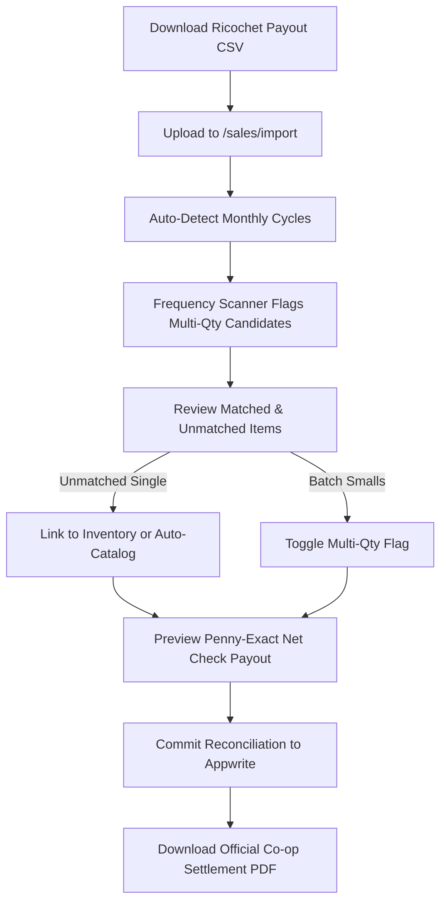

# Sales Reconciliation, Payout Sync & Settlement SOP

> **Standard Operating Procedure (SOP)**: Monthly sales ingestion, automated item matching, multi-quantity batch stock management, and co-op settlement distribution for **Resale Command**.

---

## 1. System Overview & The Ground Truth Principle

In **Resale Command**, financial accounting and inventory management follow one non-negotiable rule:
**The POS register transaction statement is the sole ground truth of what sold.**

### The Ground Truth Rules
1. **The Register is the Authority**: An item has only sold if it appears on the official POS register payout statement (e.g. Memory Den Ricochet CSV). Unsold items remain safely on booth shelves or in backstock.
2. **Terminal Sale Immutability (1 SKU = 1 Physical Unit = At Most 1 Sale)**:
   - For unique vintage, antique, and collectible secondhand items, each SKU represents a single physical object.
   - Once an item is marked `status: 'sold'`, it reaches its terminal lifecycle state and can **NEVER** sell again.
3. **Multi-Quantity Batch Stock Exception**:
   - Batch stock items ($10 book packs `0EJ0F9`, felt hats `0EJ0DC`, enamel pins, stickers) are repeated across multiple customer tickets.
   - Multi-quantity items are explicitly flagged and permitted to record multiple distinct sales without deduplication rejection.

---

## 2. Multi-Quantity Batch Stock Architecture

### Why Multi-Quantity Exists in Antique Booths
In antique mall booths, high-velocity smalls ($10 fantasy paperback combines, $15 felt hat packs) share a single pre-printed barcode to minimize tagging labor and maximize impulse floor sales.

### The Appwrite Collection Schema Invariant
- Appwrite strictly validates collection schemas on all `createDocument` and `updateDocument` calls.
- In the `items` collection, the supported integer attribute is **`quantity`** (integer, default `1`).
- Appwrite **DOES NOT** contain an `isMultiQty` boolean attribute.
- **Rule**: Never pass `isMultiQty` to Appwrite databases. Instead, write `quantity: isMulti ? Math.max(2, repeatCount) : 1` to Appwrite, and hydrate `isMultiQty: true` in frontend reactive memory whenever `quantity > 1`.

```typescript
// Correct Appwrite Write Pattern:
const payload = {
  ...itemData,
  quantity: isMulti ? Math.max(2, repeatCount || 2) : 1
};
delete (payload as any).isMultiQty; // Strict schema protection

// Correct Reactive Read Pattern:
const isMultiQty = (item.quantity && item.quantity > 1) || !!item.isMultiQty;
```

### Automated Multi-Quantity Detection in Importer
When an operator uploads a multi-month payout CSV:
1. **Frequency Pre-Scan**: The importer immediately counts SKU occurrences across all rows.
2. **Candidate Badge**: Any SKU appearing $\ge 2$ times is automatically flagged with `📦 Multi-Qty (Sold Nx in file)`.
3. **1-Click Row Toggle**: Clicking `[ Multi-Qty ]` / `[ Single ]` toggles all rows for that SKU simultaneously.
4. **Dedicated Filter Tab**: The `Multi-Qty (X)` tab lets operators review and isolate all batch stock in one click.

---

## 3. Data Isolation: Dev vs. Production Ground Truth

During the audit of historical transactions, 8 test sales dated `2026-10-18` were inspected:
- `0EJ00C` Steampunk Bowler w/ Goggles
- `0EJ00B` Steampunk Bowler Blue Roses
- `0EJ009` Cyberpunk A Forlorn Hope CP3101
- `0EJ008` D&D 5e Core Rule Set
- `0EJ006` McFarlane Berserker Dragon
- `0EJ005` McFarlane Sorcerer's Dragon
- `HUCK-1184` HUCK-1184
- `0EJ002` McFarlane Water Dragon

### Investigation Finding:
- 6 of the 8 items (`0EJ00C`, `0EJ00B`, `0EJ006`, `0EJ005`, `HUCK-1184`, `0EJ002`) **never sold** and do not exist in the official Memory Den payout history.
- The `2026-10-18` records were synthetic test transactions created during development.
- **Law**: Dev mock records must never contaminate live financial reconciliations. Official reconciliations are run exclusively against verified POS CSV statements.

---

## 4. Financial & Payout Mathematics

### The Memory Den Ricochet Payout Equation
Every monthly payout statement from Memory Den follows exact-to-the-penny arithmetic:

$$\text{Net Check Payout} = \text{Gross Register Sales} - \text{Mall Commission (15\%)} - \text{Space Rental (\$382.50)}$$

| Variable | Definition | Example (June 2026) |
| :--- | :--- | :--- |
| **Gross Register Sales** | Total retail checkout amount across all booth sales | $1,570.00 |
| **Mall Commission (15%)** | 15% withheld by Memory Den for checkout/merchant processing | -$235.50 |
| **Net Sales (85%)** | Retail revenue retained by the booth before rent | $1,334.50 |
| **Space Rental** | Fixed monthly booth rent deducted by mall from payout check | -$382.50 |
| **Net Check Payout** | Physical check issued to Huckleberry Collective | **$952.00** |

### Proportional Overhead Sharing Law (Anti-Host Subsidy)
When multiple partners (e.g., Huckleberry Collective `HUCK-`, PDX Greenlight `PDXGL-`, B&B `BB-`) sell within a shared booth:
1. **Shared Floor Space = Shared Rent**: Outside consignors and partners MUST pay their proportional share of booth rent based on their share of gross sales:
   $$\text{Partner Rent Share} = \left( \frac{\text{Partner Gross Sales}}{\text{Total Booth Gross Sales}} \right) \times \text{Fixed Booth Rent}$$
2. **Absolute Prohibition of Flat 85% Consignor Payouts**:
   - If a consignor receives a flat 85% cut and the mall takes 15%, exactly 0% remains to pay the $382.50 booth rent.
   - The managing operator would be subsidizing outside inventory at an operational loss.
   - Therefore, partner profit is distributed **after** proportional rent contribution.

---

## 5. Continuity & Resilience Guardrails

### Staging Table Continuous Auto-Save
- Reconciling multi-month statements with dozens of items takes time.
- The importer continuously saves staging state to `localStorage` (`rc_sales_importer_staging_v1`) on every parse, match, link, unlink, and month filter switch.
- Tab closures, accidental navigation, and dev server reloads **never** lose in-progress operator work.

### Historic Settlement Archive
- When an operator clicks `Commit Reconciliation`:
  1. Matched inventory documents transition to `status: 'sold'`.
  2. Verified sales records are created in the `sales` collection.
  3. The entire reconciliation report is permanently archived in `localStorage` (`rc_sales_reconciliation_history_v1`).
- Operators can view historic payout statements, search past settlements, and re-download PDF distribution reports at any time.

---

## 6. End-to-End Operator Workflow



1. **Upload**: Drop the venue payout CSV into `/sales/import`.
2. **Select Month**: Select the target monthly payout cycle (e.g. `2026-06`).
3. **Verify Matches**:
   - Green rows indicate exact SKU matches in the inventory catalog.
   - Blue badges highlight detected multi-quantity items.
4. **Resolve Unmatched**:
   - Use the **Matcher Drawer** to link to existing un-SKU'd catalog items, OR
   - Tap `Auto-Create Unmatched` to catalog remaining sold items with official barcodes.
5. **Verify Math**: Check the summary cards against the venue check to ensure penny-exact parity.
6. **Commit**: Tap `Commit X Sales to Database`. All items update to `sold`, sales are recorded, and the settlement PDF is generated.
