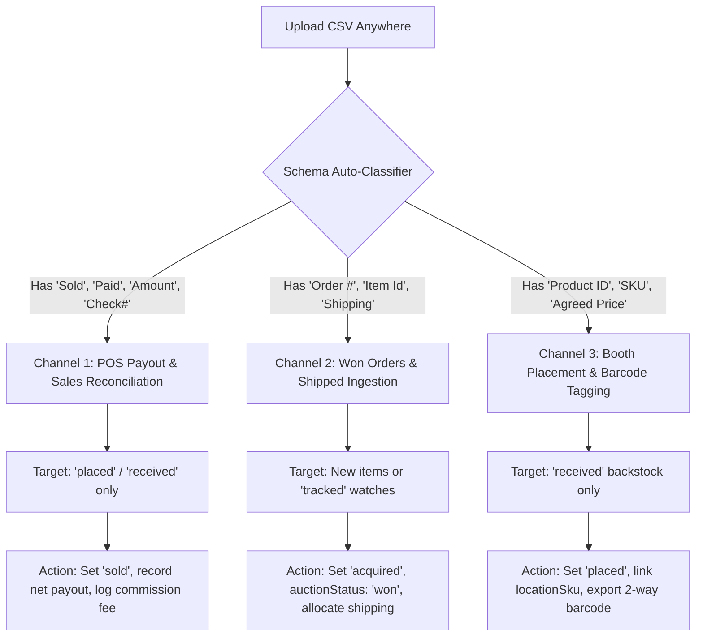

# Resale Command - Unified Inventory & Auction Flow Architecture

This document defines the single, locked-down flow architecture for all inventory, auction tracking, order ingestion, booth placement, and sales reconciliation in Resale Command.

---

## 1. The Single Source of Truth: Canonical 5-Stage Lifecycle

Every item moves strictly forward through the canonical 5-stage lifecycle. No tool or sync may violate these state transitions:

```
[tracked]  ──>  [acquired]  ──>  [received]  ──>  [placed]  ──>  [sold]
 Pre-Buy         Won Order       Backstock       Retail Floor     Terminal Sale
(Watchlist)     (In-Transit)    (Huck's Garage)  (Memory Den)     (POS Payout)
```

| Lifecycle Stage | Status Value | Physical Reality | Default Location | Allowed Sourcing / POS Ingestion Flow |
| :--- | :--- | :--- | :--- | :--- |
| **Stage 1: Pre-Buy** | `tracked` / `draft` | Watching live auction or scout comp. **Zero money spent, not owned.** | `null` / URL | Speed Scout AI, Cart Watchlist |
| **Stage 2: Acquired** | `acquired` | **Won auction** or paid online order. Awaiting shipment or in-transit. | `In-Transit` / `HD` | Shipped SGW CSV, Purchase Order |
| **Stage 3: Received** | `received` / `in-stock`| Box opened, item physically inspected, sitting in warehouse backstock. | **`HG`** (Huck's Garage) | Haul Ingestion Wizard, Trip Finisher |
| **Stage 4: Placed** | `placed` | Thermal barcode tagged, physically staged or placed in booth shelf. | **`MD`**, **`DT`**, Booth # | Location Manifest, Booth Placement |
| **Stage 5: Sold** | `sold` | Item purchased at POS, cash in hand, net payout settled. | Historical | Ricochet POS Payout CSV, Cash Sale |

---

## 2. Invariant Laws (Locked Down Once and For All)

### Law 1: The Lifecycle Immunity Law (Pre-Buy Protection)
> **Items with `status: 'tracked'`, `'draft'`, or `'scouted'` CAN NEVER be modified by any retail store sync, placement tool, or sales reconciliation report.**

- Store syncs and payout reports operate exclusively on physical goods (`received` or `placed`).
- If an item is unacquired, it is strictly invisible to booth placement tools.

### Law 2: The Shipped Orders are Won Auctions Law
> **When a user uploads a "Shipped Orders" CSV from ShopGoodwill or an auction house, every line item is a WON AUCTION / COMPLETED ORDER.**

- Status MUST be set to `status: 'acquired'`.
- Auction status MUST be set to `auctionStatus: 'won'`.
- Storage location MUST default to `HG` (or `In-Transit`).
- Bidding warnings and countdown badges MUST BE INSTANTLY PURGED.

### Law 3: The Auction Expiration & 1-Click Resolution Law
> **When an auction passes its `auctionEndsAt` time limit, the user must be able to resolve it in exactly 1 click without repetitive multi-step clicking:**

1. **🏆 Mark Won**:
   - Instantly transitions item to `status: 'acquired'` and `auctionStatus: 'won'`.
   - Records final winning bid as cost basis.
   - Clears the ended auction badge.
2. **✕ Delete / Discard**:
   - Instantly deletes or marks lost, completely removing the dead watch from inventory and watchlist.
3. **Bulk Resolution**:
   - In the bottom action dock (`BottomActionTray.vue`), selecting ended auction items displays direct **"🏆 Mark Won"** and **"🗑️ Remove"** buttons.

### Law 4: The Auction Alert Suppression Law
> **An item that is `acquired`, `received`, `placed`, or `sold` MUST NEVER display auction alerts (`⏰ Ended (Won or Lost?)`, `🛑 Outbid`, `🎯 In Play`).**

- `ItemCard.vue` and all grid/table views check `isLiveAuctionActive(item)`.
- If an item is placed on a booth shelf or sold, it is physically owned—showing auction expiration badges is an architectural error.

---

## 3. The 3 Universal Ingestion Channels

Instead of fractured, conflicting uploaders, all CSV files pass through one unified classifier:



### Channel 1: POS Payout & Sales Reconciliation (Ricochet / Memory Den Payouts)
- **Input Indicators**: Headers include `Sold`, `Paid`, `Amount`, `Check#`, `Sale`, `Cost/Split`.
- **Target Items**: Physical items currently `placed` or `received`.
- **Strict Exclusions**: Unacquired watches (`tracked`) are skipped with 0% chance of corruption.
- **Actions**:
  1. Matches exact UPC (`HUCK-XXXX`, `PDXGL-XXXX`) or location SKU (`0EJ0...`).
  2. Fallback matches on high-confidence cleaned titles (similarity > 85%, minimum length 10 characters).
  3. Sets `status: 'sold'`.
  4. Sets `soldPrice`: Net payout take-home amount (e.g., `$170.00`).
  5. Sets `resalePrice`: Gross sticker price (e.g., `$200.00`).
  6. Creates sales transaction with recorded booth commission fee (`Gross - Net`).

### Channel 2: Shipped Orders & Won Ingestion (ShopGoodwill, eBay, Invoices)
- **Input Indicators**: Headers include `Item Id`, `Order Date`, `Shipping`, `Handling`.
- **Target Items**: Matches pre-buy `tracked` drafts or creates new items.
- **Actions**:
  1. Sets `status: 'acquired'`.
  2. Sets `auctionStatus: 'won'`.
  3. Calculates landed unit cost: $\text{Item Bid} + \left( \frac{\text{Order Shipping}}{\text{Items in Order}} \right)$.
  4. Auto-creates Purchase Order (`PO-{orderId}`) in purchases collection.
  5. Clears all auction timers.

### Channel 3: Booth Placement & Barcode Tagging (Active Catalog Floor Sync)
- **Input Indicators**: Headers include `SKU`, `Product ID`, `Agreed Price`, NO `Sold`/`Paid`.
- **Target Items**: Backstock items (`received`).
- **Actions**:
  1. Links booth SKU tag to `item.locationSku`.
  2. Sets `status: 'placed'`.
  3. Injects custom UPC into CSV or exports browser userscript for Ricochet DevTools.

---

## 4. Bulk Actions & Table Reactivity Standards

To prevent freezing, slow reloads, and multi-clicking:
1. **Safe ID Extraction**:
   - `BottomActionTray.vue` extracts item IDs via:
     ```ts
     props.selectedItems.map(i => typeof i === 'string' ? i : (i.$id || i.id)).filter(Boolean)
     ```
2. **Optimistic Local State**:
   - When a bulk action completes, the local reactive array (`inventoryItems`) is updated in memory immediately.
   - The UI never triggers a 25-page, 2,500-item cloud refetch just to update 2 items.
3. **Selection Auto-Clear**:
   - On bulk delete or bulk status change, selected IDs are cleared automatically so the user never sees "ghost selections".
4. **Dock Event Binding**:
   - Every bottom tray event (`@apply-status`, `@apply-location`, `@delete`, `@bundle`, `@combine`) is strictly wired to matching handlers in both `InventoryTableView.vue` and `InventoryManager.vue`.
